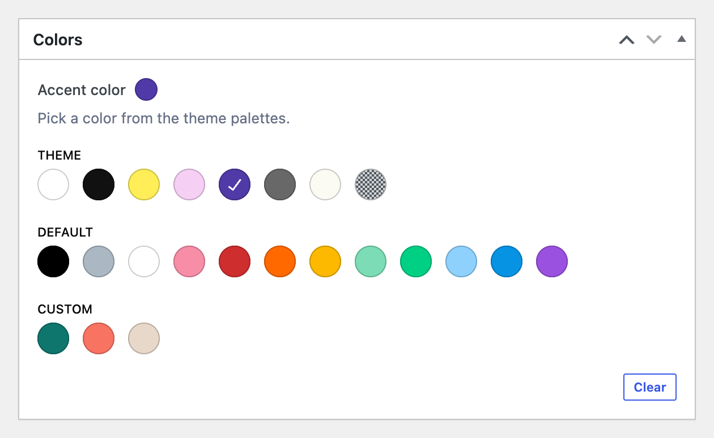

# ACF Color Palette field

[](https://github.com/nlemoine/acf-color-palette/releases)
[](https://packagist.org/packages/n5s/acf-color-palette/stats)
[](https://codecov.io/gh/nlemoine/acf-color-palette)
[](https://playground.wordpress.net/?blueprint-url=https://raw.githubusercontent.com/nlemoine/acf-color-palette/main/blueprint.json)

Adds a 'Color Palette' field type for the [Advanced Custom Fields](https://wordpress.org/plugins/advanced-custom-fields/) WordPress plugin (free or PRO).



### Overview

Pick a color among the colors of your theme, the way the block editor color picker does. Colors come from the global settings: the `theme.json` palettes on block themes, or `add_theme_support('editor-color-palette')` on classic themes.

The field shows up to three palettes, as the block editor does:

- **Theme**: the colors of the theme;
- **Default**: the WordPress default colors;
- **Custom**: the colors created in the Site Editor global styles.

When no palette is selected in the field settings, the field shows the palettes of the block editor color picker: the default palette is hidden when the theme sets `settings.color.defaultPalette` to `false`, as Twenty Twenty-Five does.

The field stores the color slug, not its value: when the theme changes a color, fields using it follow. A stored color the field settings no longer include stays selected, in a "Current color" group.

The swatches are radio buttons: <kbd>Tab</kbd> moves to the selected color, arrow keys pick another one.

### Requirements

- WordPress 6.0+
- PHP 8.3+
- ACF 6.0+ (free or PRO)

### Field options

| Option | Default | Description |
| ------------- | ------------- | ------------- |
| Color palettes | block editor palettes | The palettes to show |
| Include colors | all | Only show these colors |
| Exclude colors | none | Hide these colors |
| Default value | empty | Default color, as a color slug |
| Return format | `slug` | See below |
| Allow null | `false` | Show a "Clear" button to empty the field |

### Return formats

`get_field()` returns, for a color `primary` named "Primary" with the value `#0d6efd`:

| Return format | Value |
| ------------- | ------------- |
| Slug (`slug`) | `'primary'` |
| Slug, name and color (`array`) | `['name' => 'Primary', 'slug' => 'primary', 'color' => '#0d6efd']` |
| Name (`name`) | `'Primary'` |
| Color value (`color`) | `'#0d6efd'` |

`get_field()` returns `null` for an empty field, and for a color that no longer exists in the palettes.

Since the slug is stored, you can use the preset CSS variable WordPress generates for each color:

```php
printf('<div style="background-color: var(--wp--preset--color--%s)">', esc_attr(get_field('color')));
```

When a slug exists in several palettes, the field resolves it like this CSS variable: custom colors first, then theme colors, then default colors.

### Integrations

- **REST API**: the field schema lists the slugs of the field colors, and other values are rejected. `null` empties a field that is not required.
- **[Admin Columns](https://wordpress.org/plugins/codepress-admin-columns/) 7+** (free or Pro): custom field columns show a color swatch and the color name.
- **[WPGraphQL for ACF](https://wordpress.org/plugins/wpgraphql-acf/) 2+**: color palette fields are exposed as an `AcfColorPaletteColor` object (`slug`, `name`, `color`), whatever the field's return format. `name` and `color` are `null` for a color no longer in the palettes.

```graphql
{
  post(id: 1, idType: DATABASE_ID) {
    postColors { accentColor { slug name color } }
  }
}
```

### Installation

#### Zip

[Download acf-color-palette.zip](https://github.com/nlemoine/acf-color-palette/releases/latest/download/acf-color-palette.zip) from the latest release and extract it to your plugins folder. The "Source code" archives GitHub adds to each release are not installable: they lack the autoloader.

#### Composer

```bash
composer require n5s/acf-color-palette
```

Composer installs use your project's autoloader: the site must load Composer's `vendor/autoload.php`, as [Bedrock](https://roots.io/bedrock/) does. Without an autoloader, the plugin shows an admin notice and stays inactive.

Classes and methods marked `@internal` are not part of the public API and may change in minor versions.

### Upgrading

From 0.x, see [UPGRADE-1.0](UPGRADE-1.0.md).

### Contributing

See [CONTRIBUTING](CONTRIBUTING.md).

### Support

If you use this field in a commercial project, please consider [supporting it on Open Collective](https://opencollective.com/n5s).

### License

[MIT](LICENSE.md)
